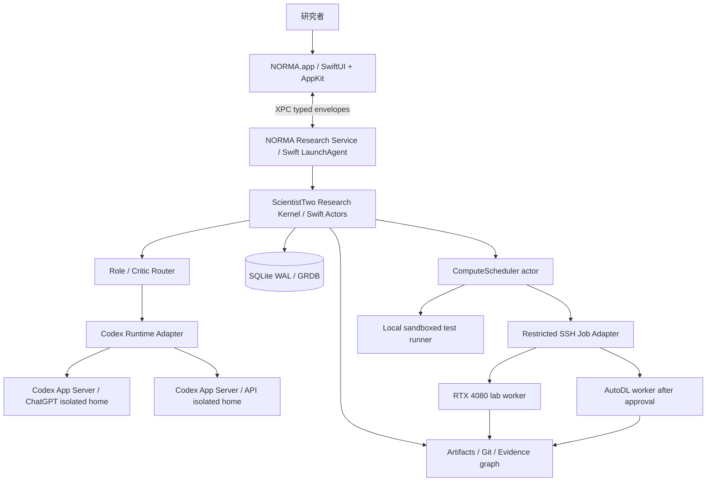
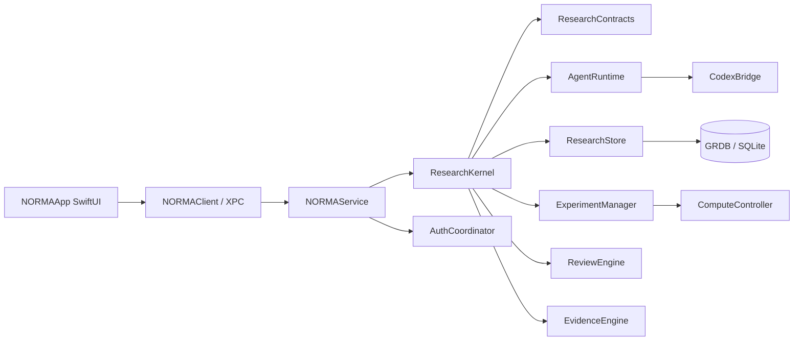
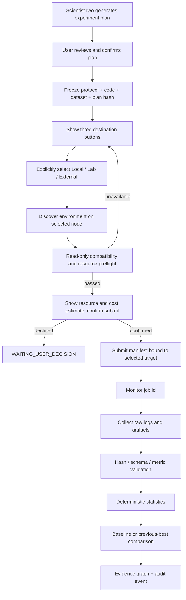
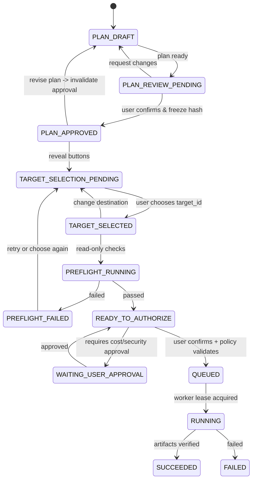

# NORMA（诺玛）— Swift 原生自主科研 Agent 系统设计规格

> **文档版本**：3.2 / Native Swift Architecture / 2026-11-06  
> **文档状态**：**架构设计冻结候选版（已纳入实验节点手动选择门禁）**；供设计审查和后续 Codex 逐模块编码使用。尚未实施或验证软件。  
> **产品类型**：macOS 原生桌面自主科研工作站（SwiftUI + AppKit）；无需浏览器 Web 前端，也不依赖 Tauri/WebView。  
> **运行环境**：Mac mini M4 / 16GB；已安装 Codex；实验室 Ubuntu + RTX 4080（SSH/Tailscale）；AutoDL 按需。  
> **模型认证**：ChatGPT 账户登录及 OpenAI API Key 双模式，显式选择、独立凭据、独立计费。  
> **架构权属**：本设计文档定义系统约束与接口，Codex 后续只承担编码、测试、缺陷修复；涉及架构偏离必须提交变更说明。

---

## 0. 阅读顺序、设计来源与硬约束

### 0.1 优先级

1. **科研方法论**：优先严格实现 Google Cloud AI Research 的 *ScientistTwo: Pioneering the Human Knowledge Frontier with Autonomous AI* 六阶段科研闭环。
2. **macOS 原生性**：SwiftUI / AppKit、Swift Concurrency、Swift 后台服务、macOS 系统能力优先。
3. **NORMA 辅助思想**：长期研究记忆、中断恢复、统一科研工作台、证据与依赖追踪。
4. **Codex 工程适配**：将论文中的模型与代码执行器替换为 Codex；保持科研逻辑的模块独立性。

### 0.2 来源等级标记

- **[P]** 论文公开文本、图、表明确支持的机制。
- **[N]** 为 NORMA 的用户设备、原生交互、安全与长期运行增加的工程设计。
- **[V]** 需在实际 Codex / Mac mini / RTX 4080 环境上验证的假设。
- **[U]** 原论文、第三方实现或供应商尚未公开到可精确复现的细节。

### 0.3 不可变规则

- 科研结果由真实实验、实际日志和确定性统计计算支持；模型自由文本不能伪造执行结果。
- 固定数据协议、评价指标、实验预算、代码版本和生成的原始证据要形成可查询的引用链。
- UI 可关闭，已批准的后台任务依然由独立 Swift 后台服务管理；服务状态必须持久化。
- 新增付费云资源、超预算实验、删除重要数据、系统级安装、对外发布必须得到人工批准。
- **每份待执行的实验方案先经研究者确认并冻结，再显示「本机实验 / Lab 服务器 / 外部服务器」三个选择按钮；未经目标选择、预检及提交确认禁止启动实验**。
- 现有 `~/.codex` 和已登录状态不得被 NORMA 静默覆盖。
- 真实论文投稿、最终创新性认可、科研伦理责任由研究者决定。

### 0.4 原论文主要依据

- [S1] 原文：https://arxiv.org/html/2609.19644（Figure 3、Figure 4、Table 1、§3.1–§3.6、§4、Appendix A.2、Appendix B）。
- [S2] 项目主页：https://scientist-two.github.io/ 。
- [S3] Codex App Server：https://learn.chatgpt.com/docs/app-server 。
- [S4] Codex 环境变量：https://learn.chatgpt.com/docs/config-file/environment-variables 。
- [S5] Apple SMAppService：https://developer.apple.com/documentation/servicemanagement/smappservice 。
- [S6] Apple NSXPCConnection：https://developer.apple.com/documentation/foundation/nsxpcconnection 。
- [S7] Apple NavigationSplitView：https://developer.apple.com/documentation/swiftui/navigationsplitview 。
- [S8] Apple Swift Charts：https://developer.apple.com/documentation/charts 。
- [S9] GRDB Swift SQLite：https://swiftpackageindex.com/groue/GRDB.swift 。

> **复现边界**：现阶段依据公开论文定义 ScientistTwo 的算法级复现契约。公开内容未能保证所有内部 prompt、私有框架、实现细节或官方源码可获得；这些项目保留 [U] 标记。论文作者报告的成绩仅作背景，不能视为 NORMA 预期性能。

---

# 第一部分：产品与系统架构

## 1. 产品目标

### 1.1 NORMA 是什么

NORMA 是运行于个人 Mac mini 的 **原生自主科研 Agent**。研究者输入科学问题、已有基线、数据和预算；NORMA 自动执行目标拆解、文献和局限核查、假设生成、实验实现、Subset 筛选、Full-set 评估、消融分析、论文撰写、模拟同行评审、补充实验及 Meta-Review，最终产出可审计的论文草稿、方法实现和实验记录。

**核心交付定义**：

`Research Problem + Research Contract + Resource Budget → Versioned Hypothesis Tree + Reproducible Experiment Repository + Evidence-backed Manuscript`

### 1.2 V1 业务范围

- 单用户；单台 Mac mini 控制中心；可拥有多个研究项目，但只允许 **一个活跃科研闭环**，其内部 GPU 作业仍可受控并行。
- 支持计算科学、ML/LLM 的代码型研究；通过插件扩展不同科学领域。
- 含本地科研文献与文件索引；远端 GPU 服务器只承担实验任务。
- 默认中文 UI，可切换英文；研究输出语言按项目配置。
- 研究结果可以是失败、无足够证据、资源不足或有效改进；系统不会强行生成“成功论文”。

### 1.3 V1 非目标

- 多租户 SaaS、远程浏览器管理、iOS 同步、自动创建无限量付费实例。
- 在 Mac mini 16GB 内存上直接运行大规模训练任务。
- 将 Meta-Review 的自动评分直接解释为真实顶会录用决定。
- 默认安装新系统守护程序、以 root 权限运行科研代码、绕过实验室资源配额。

## 2. 技术决策总表

| 层级 | 首发技术 | 采用理由 | 备注 |
|---|---|---|---|
| GUI | SwiftUI + AppKit | 原生窗口、菜单、快捷键、系统设置 | **正式选型** |
| UI 架构 | MVVM 风格的单向状态投影 + Observation | 统一持久服务状态，不让 UI 持有真实科研任务 | [N] |
| 后台服务 | Swift helper / LaunchAgent + `SMAppService` | 关闭主窗口后科研任务仍可管理 | 登录会话和电源状态有边界 |
| IPC | XPC (`NSXPCConnection`) + 版本化 `Data` 消息 | 本机安全进程通信 | 不开放普通 HTTP 服务 |
| 科研核心 | Swift Actors + 显式状态机 | 逻辑清晰、持久化、可测试 | **主控制平面纯 Swift** |
| 模型运行时 | Codex App Server | 会话、工具调用、审批、登录 | 版本兼容层 [V] |
| Codex 传输 | 默认 stdio JSONL | 避免额外开放网络监听端口 | 单独进程与会话 |
| 数据 | SQLite WAL + GRDB | 适合 Mac mini 单用户持久系统 | 单写者约束 |
| 文件 | 内容寻址对象库 + Git 仓库 | 代码、配置、原始证据可追踪 | SHA-256 |
| GPU 调度 | Swift actor + 目标手选门禁 + 系统 SSH 命令/受限 Worker 协议 | 研究者明确选择执行位置，随后受控提交 | 不给模型直接 SSH 私钥 |
| 科学实验 | Python/uv/Conda/Docker、PyTorch、NumPy、SciPy（独立 worker） | 自动发现、复用已有科研环境 | **科研插件，非控制后端** |
| 环境管理 | Swift `EnvironmentCatalog` actor + 只读本地探测器 | 发现 uv / Conda / Docker 并匹配实验需求 | [N] 环境修改需要审批 |
| 图形 | Swift Charts、AppKit Table/OutlineView | 原生数据图、长表格、层级树 | 无浏览器依赖 |
| 密钥 | Codex 独立状态目录 + macOS Keychain | 模型凭据与本机隐私隔离 | 不写入科研数据库 |
| 安装分发 | `.app` + 签名/公证（分发阶段） | 原生产品 | 首期个人设备可直接本地调试 |

## 3. 进程部署拓扑



### 3.1 进程边界

**NORMA.app**（GUI）只负责布局、交互、状态呈现、授权与批准。窗口关闭不会决定科研任务是否终止。

**NORMA Research Service**（用户权限运行）拥有工作流、数据库写入权、模型子进程、SSH 调度权和审批状态。用 `SMAppService` 注册用户登录后可运行的后台 helper；`NSXPCConnection` 提供本机控制与事件订阅。V1 不需要 root helper。

**Codex App Server** 是第三方本地进程；以 `Process` 启动，标准输入输出由受控桥接器占用。每个认证 profile 独立 `CODEX_HOME`；崩溃后通过持久化 thread ID 尝试恢复。

**Experiment Worker** 是独立的科研代码执行环境。应接受经过校验的 `ExperimentManifest`，不能读取 Mac mini 上的密钥。GPU 端使用现有实验室环境或 AutoDL 已经配置的环境。

### 3.2 macOS 生命周期

1. 首次启动 NORMA.app → 建立 `Application Support/NORMA` 目录 → 执行可回滚的数据库迁移 → 检查后台服务注册状态。
2. 用户允许“登录时启动科研服务”后注册 helper；helper 再次运行时先扫描任务检查点与远端作业状态。
3. 窗口关闭 → UI 断开 XPC；后台服务继续已批准的任务并接受系统通知需求。
4. 用户明确选择“退出并停止科研” → 发出协作取消、等待有限时长、收集恢复检查点；未能取消的远端作业标记为 `CANCEL_PENDING` 并继续跟踪。
5. Mac 进入睡眠/关机 → 服务运行中断；恢复后重新确认实际远端状态；**不承诺休眠期间 Mac 本地持续计算**。
6. 登录会话未激活时 LaunchAgent 的可用性受 macOS 会话与登录状态约束；V1 不承诺登出后继续运行本地控制平面。

### 3.3 UI → helper 通信

XPC 消息采用 `Data` + Codable JSON Envelope，避免把 Swift 具体类型 ABI 暴露到进程边界：

```json
{
  "schema_version": "1.0",
  "request_id": "req_uuid",
  "method": "research.pause",
  "params": {"research_id":"res_uuid","expected_revision":42},
  "issued_at": "2026-11-06T00:00:00Z"
}
```

响应 `{request_id, result|error, event_revision}`；事件 `{event_id, aggregate_id, sequence, kind, payload}`。UI 断开重连时先请求数据库快照，再从 `last_event_sequence` 续订增量事件；重复事件按 event_id 去重。

**安全边界**：只接受同一受信任应用签名/用户会话发起的连接；即使是本机 IPC，也必须验证身份、消息版本、资源所有权和高风险操作授权。

---

# 第二部分：ScientistTwo 研究内核——论文保真契约

## 4. 六组 Agent 与实际内部角色 [P]

ScientistTwo Figure 3 是六大逻辑模块，每组包含多个内部 Agent。工程实现不得将其简化成六次独立文本聊天。

| 逻辑组 | 内部角色及职责 | 规范化产物 | 论文位置 |
|---|---|---|---|
| Idea Generator | Limitation Extractor、Limitation Verifier、Seed Idea Generator、Novelty Checker、Idea Evolver | `LimitationSet`, `SeedIdea[]`, `NoveltyEvidence[]`, `IdeaTrace[]` | §3.1、§3.3 |
| Evaluator | Baseline Coder、Subset Coder/Critic/Engineer、Full-set Coder/Critic/Engineer、Idea Implementer | `BaselineResult`, `ExperimentResult`, `IdeaVerdict` | §3.2 |
| Analyzer | Best Idea Selector、Ablation Planner/Coder/Critic、Full-set Engineer、Result Comparison | `BestCandidate`, `AblationReport`, `ComparisonReport` | §3.3、§3.4 |
| Writer | Initial Drafter、Paper Enhancer（论文集成 PaperOrchestra） | `Manuscript`, `ClaimIndex`, `FigureManifest` | §3.5 |
| Peer-Review | Peer Reviewer（论文采用 ScholarPeer）、Rebuttal Planner/Coder | `Review`, `RebuttalTask[]`, `SupplementaryResult[]` | §3.5 |
| Meta-Review | Meta Reviewer、核心方法修订的回流工作流 | `MetaReview`, `ReviewRefinementPlan` | §3.6 |

角色是**隔离的任务实例及权限集**，并不要求 Mac mini 同时运行二十多个模型进程。多个逻辑角色可复用同一 Codex App Server，但各自有不同 thread、workspace、输入快照、工具权限与审计记录。

## 5. 通用 Candidate–Critic–Refine [P]

Figure 4 的通用阶段：候选产物 → Critic 输出 `accept / refine / reject` → 接受、修订或丢弃；有最大迭代次数。

**NORMA 增强 [N]**：通用判决枚举与实验特有判决分开处理：

- `GenericVerdict`: `accept | refine | reject`
- `IdeaExperimentVerdict`: `good | engineer | bad`
- `AblationVerdict`: `good | refine`
- `MetaVerdict`: `accept | refine`

禁止把模型的“我认为成功”直接映射成已验证完成。每次 Critic 之前都先经过 `EvidencePreflight`：确认所需文件存在、哈希匹配、协议一致、指标有效、实际作业结束码有效。缺项时转为 `BLOCKED_EVIDENCE`。

## 6. 阶段一：局限提取与种子假设 [P]

输入 `ResearchContract` + 人类 SOTA 文献/代码 + 当前论文证据库。

1. Limitation Extractor 提取可证伪、与目标任务相关的局限。
2. Limitation Verifier 判断是否充分；若不足，补充遗漏，并在上限内迭代。
3. Seed Generator 根据局限提出方法候选；每个假设应包含机制说明、预期可改善的指标、风险、必要实验。
4. Novelty Checker 进行文献比对，形成 `NoveltyEvidence` 和排序分数，候选按新颖性排序。
5. 首轮只送前 `N0` 个候选到实现阶段；剩余未尝试种子保留在探索池。

**NORMA 的证据规则 [N]**：Novelty 评分属于筛选信号，不能自动证明“全球首次”。文献条目需验证 DOI/arXiv/出版社来源；无法检索到相关论文时给出不确定性。

## 7. 阶段二：Baseline → Subset → Full-Set [P]

- 先复现 **Subset baseline**，保存代码、日志、数据划分和指标。基线复现失败时暂停所有增量方法比较。
- `Subset Coder` 在该基线代码上实现候选；`Subset Critic` 与同一条件下的基线比较。
- `bad`：明显低于基线，保留失败证据，停止候选。
- `good`：稳定超过基线且满足约束，提交 Full-set。
- `engineer`：尚有潜力但需修复/调参，在 `N_eng` 内循环；耗尽仍未达到 `good`，按论文策略判为 `bad`。
- `Full-set Coder` 扩展到完整 benchmark；`Full-set Critic/Engineer` 对原 SOTA 和完整指标检查。

**防科研作弊门禁 [N]**：不可修改锁定的 metric code、label、验证拆分与禁止的 benchmark harness；如果方法确实需要新评价协议，要创建 `protocol_version` 并重新跑基线，不能把不同协议的分数直接比较。

## 8. 阶段三：Idea Evolution 与 Selector [P]

第 0 轮执行高排名初始 seed。第 k 轮输入是所有历史执行轨迹：

`Trace = (idea, code, results, verdict, feedback, cost, diagnostics)`

Idea Evolver **同时使用成功轨迹与失败轨迹**提出新假设；另从未尝试的高新颖度种子池补入候选，避免搜索坍缩在局部最优。候选重复时按 `hypothesis_fingerprint` 去重；可保留不同方法独立来源。

若累计成功候选达到阈值或达到最大研究轮数，结束演化。未发现任何通过 Full-set 的 `good` 时，终止该研究为 `NO_VALIDATED_CANDIDATE`，保留诊断，不进入论文“成功”路径。

Best Selector 只从 Full-set 已验证成功候选中选择最佳方案，完整保存对比依据、成本与退化指标。

## 9. 阶段四：Ablation → Idea Refinement [P]

1. Ablation Planner 提出可执行的组件级消融方案。
2. Ablation Coder 从冻结的最佳版本创建隔离变体并真实运行。
3. Ablation Critic 判定 `good` / `refine`。
4. 若 `refine`，Full-set Engineer 根据消融反馈调整核心方法并重新运行。
5. Result Comparison 使用相同评测协议对 `new` 与 `best` 做完整比较；只有通过 `strict_improvement` 检验才可原子更新 `best`。
6. `best` 更新后重新跑消融；迭代有上限。

**机制归因要求**：单纯调大训练预算、修改超参或修改评价器造成的收益要单独标注；论文 Appendix B 显示原方法特别重视“新机制对收益的实际贡献”。

## 10. 阶段五：Writer → Peer Review → Rebuttal [P]

Writer 输入最佳完整结果、消融、代码定义、相关工作和证据关系图；输出论文草稿和 `ClaimIndex`。论文需要标记哪个数字由哪个实验导出。

Peer Reviewer 提供优点、缺点、可复现性问题和评分；分数不足时 Rebuttal Planner 生成**可以执行的补充实验任务**，Coder 实际运行，然后 Paper Enhancer 基于新证据修订稿件。

NORMA 规定：`REBUTTAL_RESOLVED` 必须具有真实实验结果或明确的“该质疑无需额外实验”的人工批准说明；模型不能用纯文字承诺关闭实验性质的质疑。

## 11. 阶段六：Meta-Review → 方法回流 [P]

Meta-Reviewer 综合稿件和 Peer Review，输出 `accept/refine`。

- `accept`：进入完整性审计，审计通过后导出“可供人类审查的稿件和代码”。
- `refine`：依据批评重新调用 Full-set Engineer 修改**核心算法**，通过 Result Comparison 后替换最佳版本；再运行所需消融、写作、审稿，循环有上限。

**注意**：内部自动评审和最终独立评审分离。论文的 ScholarPeer 用于内部反馈，Stanford Agentic Reviewer 是用于作者评估的留出评估器。NORMA 的内部模型评分不能保证真实会议接收。

## 12. 原论文配置与 NORMA 配置

| 参数 | `paper_fidelity`（Appendix A.2） | `norma_local`（建议初始） |
|---|---:|---:|
| Limitation 最大迭代 | 16 | 6 |
| 每轮 idea 实验候选 | 1 seed + 1 evolved（首轮执行 top seed） | 同结构 |
| Idea 实验最大轮数 | 4 | 3 |
| 成功 idea 提前停止阈值 | 4 | 2 |
| Engineering Refinement | 2 | 1 |
| 消融引起的方法改进 | 1 | 1 |
| Peer Review 最大轮数 | 2 | 2 |
| 自动审稿提前停止评分 | 8/10 | 8/10 + 证据门禁 |
| Review-based 核心改进 | 1 | 1 |
| Novelty 查询参考文献 | 2 篇（原论文默认） | 分层检索、数量按项目预算控制 |
| 默认模型 | Gemini 3.6 Flash + 指定阶段 Claude Code Opus 4.8 | Codex，由当时可用模型列表选择 |

以上 NORMA 数值属于**可修改的产品默认值 [N]**，并非实验最优设置。每个科研项目冻结 `profile_id + overrides + config_hash`；更改配置产生新版本。原论文未详细披露的 prompt、全部子角色参数和工具实现标记 [U]。

---

# 第三部分：Swift 科研控制内核

## 13. Swift 模块清单与分层边界

### 13.1 模块关系



### 13.2 逻辑 Packages

| Package / Target | 责任 | 可调用的依赖 |
|---|---|---|
| `NORMAApp` | SwiftUI Scene、导航、展示、审批 | Client、UI Components |
| `NORMAUI` | 原生组件库、图表、表格、日志查看 | Contracts、SwiftUI/AppKit |
| `NORMAClient` | XPC 连接、请求/事件重连、只读 ViewState | Contracts |
| `NORMAService` | 用户会话服务、服务生命周期、命令入口 | Kernel、Store、Auth、Compute |
| `ResearchContracts` | 所有公开 DTO、JSON Schema、枚举、错误码 | Foundation |
| `ResearchKernel` | 六阶段图、转移规则、持久恢复、循环预算 | Contracts、Store、Agents、Evidence |
| `AgentRuntime` | 角色权限、上下文构造、schema 校验、tool policy | Contracts、CodexBridge |
| `CodexBridge` | 启动 app-server、JSONL、RPC 映射、事件、恢复 | Foundation/Process |
| `AuthCoordinator` | 两种账户 profile、登录、额度状态、切换确认 | CodexBridge、Keychain |
| `ExperimentManager` | 协议冻结、任务计划、Subset/Full-set、结果判断 | Contracts、Compute、Evidence |
| `ComputeController` | Mac/实验室/AutoDL 路由、租约、远端作业 | Contracts、SSH |
| `ResearchStore` | SQLite migration、事务、索引、checkpoint、artifact | GRDB、Foundation |
| `EvidenceEngine` | Claim/metric/日志/代码链、CoE 审计、统计结论 | Contracts、Store |
| `ReviewEngine` | 评审报告、补充实验、Meta-Review | Contracts、Kernel |
| `TestFixtures` | Mock Codex、Fake SSH、故障注入、固定数据集 | Contracts |

### 13.3 Actor 原则

使用 Swift Concurrency 隔离可变状态：

- `ResearchOrchestrator` actor：**唯一科研决策状态所有者**；提交阶段转移及 checkpoint。
- `CodexSessionManager` actor：跟踪两个账户 profile、thread 映射、turn 生命周期。
- `ComputeScheduler` actor：统一资源队列与租约；避免重复占用 GPU。
- `ArtifactStore` actor：单一写入入口，按内容哈希存储文件。
- `AuditWriter` actor：追加事件；禁止 UI 直接改写可信审计记录。
- `AuthCoordinator` actor：账户登录状态、Keychain 引用、费用 profile 决策。

**不要**把持续运行的科研循环绑在任何 `@MainActor` ViewModel 上。UI 只持有近期页面投影，并通过 XPC 发送用户意图。

## 14. 两层状态机

### 14.1 科研阶段状态（业务）

`CREATED → CONTRACT_LOCKED → LIMITATIONS → SEED_IDEAS → BASELINE → IDEA_EXPERIMENTS → IDEA_EVOLUTION ↔ IDEA_EXPERIMENTS → BEST_SELECTED → ABLATION ↔ METHOD_REFINEMENT → DRAFT → PEER_REVIEW ↔ REBUTTAL → META_REVIEW ↔ METHOD_REFINEMENT → INTEGRITY_AUDIT → EXPORT_READY`

异常终态：`FAILED`, `NO_VALIDATED_CANDIDATE`, `STOPPED_BY_USER`, `BUDGET_EXHAUSTED`, `INTEGRITY_FAILED`, `EXPORTED`。

### 14.2 操作状态（执行）

`QUEUED`, `CLAIMED`, `RUNNING`, `WAITING_RESOURCE`, `WAITING_APPROVAL`, `WAITING_AUTH`, `PAUSING`, `PAUSED`, `RETRYABLE_FAILURE`, `FAILED`, `CANCEL_PENDING`, `CANCELLED`, `SUCCEEDED`。

阶段状态和操作状态为两个维度，避免“任务暂停导致误认为科研阶段已完成”。

### 14.3 转移规则

- 仅 `ResearchOrchestrator` 可以改变科研阶段。
- `Agent Runtime` 输出只产生**候选转移事件**；证据门禁通过后，由确定性转移函数应用。
- `ResearchStore` 将 `state_revision`、新阶段、审计事件、待派发命令写入同一数据库事务（**Transactional Outbox**）。
- Runner 的外部启动命令带 `idempotency_key`；重复请求只能查询到同一个逻辑作业。
- `expected_revision` 不匹配 → `CONFLICT_STALE_REVISION`，客户端重载后重试。
- 循环上限、预算、人工批准、锁定评估协议由独立 PolicyEngine 判断；模型无法提升自己的额度。

### 14.4 崩溃恢复

1. Research Service 启动读取 checkpoint 与未确认 outbox。
2. 对每个 `RUNNING/CLAIMED/CANCEL_PENDING` 作业先查询真实 remote ID 和 job tag。
3. 对已完成但尚未回收产物的作业补采集；对仍在运行的作业恢复监测；对不存在且不可重试的作业给出显式错误。
4. 只在明确获知远端**未执行**时重发作业；状态不确定时进入 `RECONCILE_REQUIRED` 等待人工确认。
5. Codex thread 用保存的 `thread_id` 恢复；无法恢复时开启新 thread 并附带经过审核的上下文摘要，保留原始失败事件。

---

# 第四部分：Agent 调用、数据契约与权限

## 15. Agent 调用统一契约

每次任务都需要 `AgentInvocation`、`AgentResult`、`ValidationReport`，禁止只有自由文本：

```json
{
  "schema_version": "1.0",
  "invocation_id": "inv_uuid",
  "research_id": "res_uuid",
  "role": "subset_critic",
  "stage": "idea_experiments",
  "candidate_id": "idea_uuid",
  "input_artifact_ids": ["baseline_uuid", "experiment_uuid"],
  "context_snapshot_hash": "sha256:...",
  "allowed_tools": ["read_artifact", "compare_metrics"],
  "output_schema_id": "idea_verdict.v1",
  "auth_profile_id": "profile_chatgpt",
  "max_turns": 1,
  "deadline_at": "2026-11-07T00:00:00Z"
}
```

`AgentResult` 必须包含 `invocation_id`、`thread_id`、`turn_id`、`model_id`、`prompt_version`、`output_schema_version`、`evidence_ids`、`result_artifact_id`、`actual_status`、`error_code`。流式 token 仅用于 UI 呈现；`item/completed` 和 `turn/completed` 等终态事件才可参与可信任务完成判断。

## 16. Critic 输出示例

```json
{
  "schema_version": "1.0",
  "decision_type": "idea_experiment",
  "candidate_id": "idea_42",
  "verdict": "engineer",
  "summary": "候选具有潜力，但跨句召回改善尚未达到预注册门槛",
  "evidence_ids": ["metric_set_18", "run_93"],
  "required_actions": ["recheck_candidate_generation"],
  "confidence_label": "medium"
}
```

`decision_type` 对应独立 JSON Schema，不允许跨枚举取值；如 schema 校验不通过，保留原始输出并进入 `AGENT_OUTPUT_INVALID`。

## 17. 工具权限矩阵

| 角色 | 论文/数据读 | 改代码 | 发起实验 | 审稿 | 改协议 |
|---|---|---|---|---|---|
| Limitation / Novelty | 是 | 否 | 否 | 否 | 否 |
| Seed / Evolver | 是 | 否 | 仅提交建议 | 否 | 否 |
| Baseline / Subset / Full-set Coder | 是 | 隔离 worktree | 仅经 Scheduler | 否 | 否 |
| Subset / Full-set Critic | 只读证据快照 | 否 | 否 | 否 | 否 |
| Ablation Planner | 是 | 否 | 提交计划 | 否 | 否 |
| Ablation Coder / Engineer | 是 | 隔离 worktree | 仅经 Scheduler | 否 | 否 |
| Result Comparison / Selector | 只读指标 | 否 | 否 | 否 | 否 |
| Writer | 只读证据 | 输出论文文件 | 否 | 否 | 否 |
| Peer / Meta Reviewer | 只读脱敏证据 | 否 | 通过 Rebuttal Planner | 是 | 否 |
| Rebuttal Coder | 已批准范围 | 隔离 worktree | 仅经 Scheduler | 否 | 否 |
| 用户/协议管理员 | 全部授权数据 | 通过 UI | 可批准 | 可审查 | 版本化更改 |

Reviewer 与方法实现角色需要不同的 thread，并限制读取开发过程中曾经产生的自我评价。应用可显示“审稿意见依据”及完整文本，同时不展示未经授权的内部推理隐藏内容。

---

# 第五部分：Codex App Server 与双认证

## 18. Codex Bridge 协议 [N][V]

官方 App Server 当前使用 JSON-RPC 风格消息；默认 `codex app-server` 以 stdio 传输 newline-delimited JSON。NORMA 不直接访问未公开的内部会话文件，也不自行管理 Codex 模型的推理上下文格式。

Bridge 责任：

1. 启动和监督 `codex app-server` 子进程，完成 `initialize → initialized` 握手。
2. 支持 `model/list`、`thread/start`、`thread/resume`、`turn/start`、`turn/interrupt`、`account/read`、`account/login/start` 等官方接口。
3. 以 monotonically increasing request ID 匹配 RPC 响应，独立分发无 `id` 的 server notifications。
4. 处理 `item/started`、`item/completed`、`item/agentMessage/delta`、`turn/completed`、错误和审批请求。
5. 从当前安装版本生成/校验官方 JSON Schema；对 unknown events 容忍但记录，关键字段不匹配就暂停。
6. 处理 Codex 版本升级导致的行为变化，采用 `Capabilities` 探测和兼容性测试矩阵。

**严禁使用**运行脚本拼接 stdout 文本来推测模型是否完成，或使用 `dangerFullAccess` 作为默认沙箱。当前 app-server 属于仍在演进的开发接口，V1 必须固定最低支持版本并提供回退处理。

## 19. 双账户设计

### 19.1 Profile

`ChatGPTProfile`：利用 Codex 自身管理的 `chatgpt` OAuth 登录（面向个人本地应用）；若后续符合 SIWC 正式集成条件，可新增 `ExternallyManagedChatGPTProfile`。  
`APIProfile`：`apiKey` 登录，由 Codex 接受 API Key，按 OpenAI Platform 实际 API 使用计费。

官方文档对 local/open-source app-server authentication 有兼容性说明，同时建议向 Sign in with ChatGPT 迁移；商业和托管分发必须另行核查授权条件。V1 按**个人本地原生工具**设计，不把未来商业许可视为已获得。

### 19.2 隔离方式

```text
~/Library/Application Support/NORMA/
  codex-profiles/
    chatgpt/          # CODEX_HOME A
    api/              # CODEX_HOME B
```

NORMA 启动各自 App Server 并分别设置 `CODEX_HOME`；绝不改动 `~/.codex`。API Key 原文仅在用户输入与交付给受控登录接口期间存在于内存，必要时由 macOS Keychain 持久存储；SQLite 只记录 `credential_reference`、认证状态和脱敏账户标签。

### 19.3 UI 认证过程

**ChatGPT 登录**：Settings → Accounts → Continue with ChatGPT → 调用 `account/login/start(type=chatgpt)` → 使用系统浏览器打开授权 URL → 接收 `account/login/completed` 与 `account/updated` → 检查 `account/read` → profile 变为 Ready。也需支持设备码登录作为回退。

**API Key**：Settings → Accounts → Connect API Key → 本地安全输入 → `account/login/start(type=apiKey)` → 验证认证状态 → 清空 UI 输入缓冲；不可通过普通事件日志输出 Key。

**切换 Provider**：显示当前科研任务、预估消耗与账户；用户确认后针对**下一次 Agent invocation**生效。正在运行的 invocation 绑定原 profile，不进行中途无痕迁移。跨 profile 的 thread 可能因 provider mismatch 无法 resume，需在新 profile 建立新 thread 并注入合法的上下文摘要。

### 19.4 额度和费用

- ChatGPT：显示官方可获取的 rate limit/usage 状态；其计划额度依赖用户账户，不换算为固定美元余额。
- API：记录每次调用可获取的 token 用量、模型标识、当时价格快照、费用估算；对账时将**估算**与**平台最终账单**分开。
- AutoDL：独立的云算力预算与人工审批，不能与 API 预算混为一项。
- 没有明确用户许可时，订阅额度耗尽 → `WAITING_AUTH_OR_LIMIT`，禁止自动切换到收费 API。

---

# 第六部分：实验、统计、证据与研究记忆

## 20. Research Contract（研究合同）

研究开始前冻结：

- `research_question`, `domain`, `baseline_repository`, `baseline_commit`, `reference_papers`。
- `datasets`, `splits`, `split_hashes`, `metric_definitions`, `metric_directions`, `required_constraints`。
- `subset_sampling_policy`, `full_benchmark_grid`, `locked_holdout_policy`。
- `compute_budget`, `model_budget`, `time_deadline`, `max_iterations`, `approval_policy`。
- `novelty_evidence_policy`, `minimum_reproducibility`, `artifact_retention_policy`。

**统计与审计规则必须版本化**：每个 trial 固定随机种子、样本 ID、预处理方法、数据过滤规则；模型性能比较应记录效应量、区间估计及必要的多重比较修正。

## 21. 实验生命周期



**v3.2 新增节点选择门禁 [N]：** `ExperimentPlan` 进入 `PLAN_APPROVED` 并取得不可变 `plan_hash` 之前，页面不显示执行位置按钮。确认后展示 `本机实验`、`Lab 服务器`、`外部服务器`，由研究者手选。执行地点与 `plan_hash + experiment_id` 绑定；预检和执行授权属于独立操作。节点变化、计划变化、目标环境变化均要求重新预检；计划变更还会使之前选择和授权失效。每份冻结的执行批次（同一 plan hash、相同资源约束下的有限重试）只需选择一次；新方案或扩大的资源范围需重新选择。详见 §46。

`ExperimentManifest`（最少字段）：

```json
{
  "schema_version":"1.0", "experiment_id":"exp_uuid", "research_id":"res_uuid",
  "candidate_id":"idea_uuid", "protocol_hash":"sha256:...",
  "code_commit":"git_sha", "dataset_version_ids":["dataset_v1"],
  "split_id":"subset_v1", "seeds":[17,29,41],
  "toolchain_digest":"sha256:...", "entrypoint_id":"eval_fixed_endpoints_v1",
  "resource_request":{"gpu_count":1,"min_vram_gb":12,"max_runtime_min":90},
  "target_selection_id":"target_uuid","approval_id":"approval_uuid",
  "artifact_allowlist":["results.json","stdout.log","metrics.csv"],
  "idempotency_key":"exp_uuid:attempt_1"
}
```

科学实验可以使用 Python、PyTorch 等，但由已验证的 runner 运行该 manifest；Swift 核心只接受结构化结果、退出状态和实际证据。

## 22. Best Candidate 比较

对同一 `protocol_hash + benchmark_version`：

1. 先检查关键约束（不能牺牲不可退化的安全/准确/延迟等指标）。
2. 再比较预注册主指标、效应大小和统计不确定性。
3. 若满足预设优越性条件，判定 `STRICTLY_BETTER`；若证据不足，判定 `INCONCLUSIVE`；若不满足，判定 `NOT_BETTER`。
4. 更新 `best` 必须把 `candidate_id + comparison_report_id + expected_best_revision` 原子写入。
5. 若实验协议版本变化，比较前必须在同一新协议下重跑两方；跨版本得分可以参考但不可直接排名。

这属于 NORMA 为确保结果可信而定义的确定性比较契约 [N]。ScientistTwo 使用 Result Comparison Agent 的机制 [P] 得到保留。

## 23. Evidence Graph / 四维审计

```text
ScientificClaim
  ├── Figure/Table/Paragraph
  ├── MetricSet → MetricScript → RawExperimentRun
  │                   ├── DatasetVersion + SplitHash
  │                   ├── CodeCommit + ConfigHash + Seed
  │                   └── Hardware + Logs + ArtifactHash
  └── MethodClaim → CodeChange → AblationEvidence

NoveltyClaim → LiteratureEvidence → DOI/arXiv/Publisher verification
```

四项终稿审计：

- **I1 Score Verification**：独立复跑或复核原始输出，确保论文数字可复现。
- **I2 Specification Compliance**：代码与实验规则一致，无评价器滥用、数据泄漏或越权修改。
- **I3 Reference Verification**：论文引文可查，内容与所引用主张对应。
- **I4 Method–Code Alignment**：论文描述、核心模块、代码路径和消融真正一致。

证据不足 → `INTEGRITY_FAILED` 或 `NEEDS_REVIEW`，禁止显示“已验证论文”。Hash chain 用于检测记录变化；重要 artifact 的外部备份和签名可以进一步提高可信度。

## 24. 长期记忆（NORMA 辅助思想）

三类不同生命周期的数据：

1. **Episodic Research Memory**：研究过程和假设演化轨迹（成功、失败、原因、试验环境、何时出现）。
2. **Verified Knowledge Memory**：经过文献和实验验证的研究事实，记录证据 ID、有效范围、被新证据推翻的可能性。
3. **Operational Memory**：工作流 checkpoint、预算租约、审批、远端 job ID、Codex thread 映射。

记忆进入 Agent 上下文时经过 `ContextAssembler`：按研究 ID、相关性、证据等级、最近更新和 token 预算选择；禁止将所有历史聊天无约束追加。对被推翻结论做失效标记并触发依赖的相关研究提示。

## 25. 数据库设计

核心表（建议均含 `id`, `schema_version`, `created_at`, `updated_at`，关键行含 `revision`）：

| 组 | 表 | 关键字段/约束 |
|---|---|---|
| 研究 | `projects`, `researches`, `research_contracts` | research → immutable contract revision |
| 假设 | `hypotheses`, `idea_lineage`, `idea_scores` | parent idea / novelty citation / status |
| Agent | `agent_invocations`, `agent_turns`, `critic_verdicts` | role/thread/profile/evidence/schema |
| 实验 | `experiment_protocols`, `experiment_runs`, `metric_sets` | protocol hash / code SHA / dataset hash |
| GPU | `compute_nodes`, `compute_jobs`, `resource_leases` | idempotency unique / job state / lease expiry |
| 证据 | `artifacts`, `scientific_claims`, `evidence_edges`, `audit_events` | content hash unique / append-only event |
| 写作 | `manuscripts`, `reviews`, `rebuttal_tasks`, `meta_reviews` | revision / reference / evidence |
| 运行 | `workflow_snapshots`, `outbox`, `approvals`, `account_profiles` | transition revision / approval nonce |

SQLite 采用 GRDB migrator、WAL、事务和合适的索引；大文件保存在内容寻址目录，只在数据库存引用。备份应使用一致性快照机制，不直接复制运行中的 WAL 主文件后视为成功备份。

### 25.1 数据文件位置

```text
~/Library/Application Support/NORMA/
  database/norma.sqlite
  artifact-objects/sha256/...
  research-projects/<project-id>/...
  worktrees/<research-id>/<candidate-id>/...
  reports/<research-id>/...
  snapshots/<research-id>/...
  codex-profiles/chatgpt/
  codex-profiles/api/
  logs/redacted/
  backups/
```

文件权限默认仅用户可访问，依赖 FileVault 保障整盘静态数据安全；敏感数据集使用额外访问策略。`.app` 包体内不存可变科研数据。

---

# 第七部分：SSH 异构算力调度

## 26. 调度范围

三个执行域：

- **Local Mac**：Swift 逻辑测试、文献处理、轻量统计、数据完整性校验。
- **Lab RTX 4080**：常规模型推理、Embedding、PF、受限的 GPU 实验，遵守实验室资源配额。
- **AutoDL**：大显存/大批量任务，经用户批准后使用已准备且可访问的实例。

**远端不部署 Codex 账户**：研究模型推理由 Mac 上的 Codex 提供；GPU 服务器接收实验代码/manifest 和非敏感数据。某些必须在远端进行的大模型推理使用实验内指定的模型运行时，与 Codex 账户分开。

## 27. 节点与任务协议

`ComputeNode`：`node_id`, `kind`, `ssh_alias`, `gpu_type`, `total_vram_gb`, `available_vram_gb`, `cpu_capacity`, `ram_capacity`, `policy_tags`, `available_at`, `health`, `price_per_hour`, `cost_source`。

`ComputeJob`：`job_id`, `experiment_id`, `manifest_hash`, `node_id`, `remote_workdir`, `remote_pid/job_handle`, `attempt`, `idempotency_key`, `lease_id`, `status`, `last_heartbeat`, `cost_estimate`, `actual_cost`。

### 27.1 调度规则（先人工选择执行域，再确定性调度）[N]

1. `ExperimentPlan` 尚未确认 → `PLAN_REVIEW_PENDING`，不可创建可提交的 GPU 作业。
2. 已确认并冻结的实验方案 → 在 Research Workspace **显示三张目标卡片**：`本机实验`、`Lab 服务器`、`外部服务器`；三个执行域均不预选。
3. 用户点击目标卡片后才检查该目标的已授权环境、实际 CPU/RAM/GPU、依赖、数据可访问性、配额、容量和费用。可先展示缓存的只读概况，正式提交必须重新预检。
4. 本机不满足需求 → 明确告知原因，允许返回重新选择；**不得自动转到 Lab 或云端**。Lab 服务器不满足条件时也一样。
5. 外部服务器可从 AutoDL 已创建实例或自定义 SSH Profile 选择。启动新计费实例和费用不明的任务必须有单独明确确认；不因选择「外部服务器」就自动创建实例。
6. 预检合格后展示资源与数据传输摘要，研究者点击 `确认并启动实验`；调度器仅在被授权的 `node_id` 中创建资源租约并提交。
7. 目标主机提交失败、连接中断或资源不足 → `WAITING_RESOURCE / PREFLIGHT_FAILED / UNKNOWN_REMOTE_STATE` 等可恢复状态，提示用户重新检查或改选，不静默迁移。
8. 仅当研究者事先授权同一冻结批次的重试边界时，可以在**同一选定节点**按上限自动重试；计划/环境/预算越界须重新审批。

以上手动目标选择属于 NORMA 的交互和安全增强，不改变 ScientistTwo 对实验方案、Critic 与科研结论的判定。[N]

### 27.2 SSH 适配

- 使用系统 OpenSSH 命令，显式 argv 参数，禁止将 Agent 自由文本拼接进 shell。
- 使用 SSH config alias、已验证 known_hosts、Tailscale 私有地址。Mac 保存密钥，远端不获取 API/ChatGPT 令牌。
- 远端预置受限 `norma-worker` 命令；允许 `submit/status/cancel/fetch/health`，输入 manifest，经校验后执行 allowlisted entrypoint。
- 通过 SSH/SFTP 或固定的受控归档传输 artifact，校验 SHA-256；远端重复 `idempotency_key` 返回已存在 job。
- 并发占用通过资源租约管理，启动前锁定配额，结束后释放；失去心跳先尝试查询远端真实状态。
- 对学院共享服务器，应使用专门账号、用户配额及可审计的 GPU 占用，不绕过服务器上的既有资源管理规则。

### 27.3 安全隔离

实验代码视为不可信。远端优先采用无特权容器或受限 Linux 用户 + 限制目录/网络/资源的执行环境。容器隔离是否满足目标威胁模型需在实际系统验证；运行高风险模型生成代码应先进行人工审批。

---

# 第八部分：macOS 原生 UI 详细设计

## 28. 视觉语言

**定位**：专业科研工作站，参考此前 NORMA Native 预览图的深色、克制的紫色强调，完整使用原生 macOS 组件；不加载 HTML/CSS 和 shadcn/ui 包。

| UI Token | 设计值/要求 |
|---|---|
| 主题 | 跟随系统 Light/Dark，首版重点打磨 Dark |
| 强调色 | 紫色作为流程当前态/主要 CTA 的统一强调 |
| 语义色 | 绿色=完成；琥珀=待审批；红色=失败；灰色=未开始 |
| 排版 | SF Pro / SF Mono（代码与日志）及中文系统字体回退 |
| 导航 | NavigationSplitView + 可折叠 Inspector |
| 窗口 | 默认 1440×900；建议最小 1120×720；支持全屏、多窗口 |
| 图表 | Swift Charts；避免将颜色当作唯一信息编码 |
| 大型表格 | SwiftUI Table，性能不足时替换 NSOutlineView/NSTableView |
| 快捷键 | 原生菜单栏与 Commands，键盘导航优先 |
| 内容交互 | 实时进度、单击查看证据、双击进入具体实验 |

## 29. 主工作台（三栏结构）

```text
┌─────────────────────────────────────────────────────────────────────────────────────────────┐
│ ● NORMA     项目: Semantic Watermark Research    [ChatGPT ▼]   [资源]    [暂停] [新建研究] │
├──────────────────┬─────────────────────────────────────────────┬────────────────────────────┤
│ 研究工作台        │ 研究目标 · 当前阶段 Analyzer                │ INSPECTOR                  │
│ 概览              │                                             │ Agent 事件流                │
│ 研究项目          │ [Idea]─[Evaluator]─[Analyzer]─[Writer]... │                            │
│ 假设树            │                                             │ 14:02 Subset completed     │
│ 实验              │ [当前任务 / 下一步 / 证据状态]              │ 14:05 Ablation running     │
│ 评审与 Rebuttal    │                                             │ 14:06 GPU usage 73%       │
│ 文献与证据        │ [Subset / Full-set / Ablation tabs]         │                            │
│ 算力              │                                             │ Evidence / Run / Review    │
│ 设置              │ [真实实验表格 / 可复现曲线]                │                            │
│                  │                                             │                            │
│ ─ 最近项目 ─      │                                             │                            │
│ Semantics         │                                             │                            │
│ Watermark PF      │                                             │                            │
└──────────────────┴─────────────────────────────────────────────┴────────────────────────────┘
```

上图为**布局规范**，示意信息不代表真实实验数据。三栏基于 SwiftUI `NavigationSplitView`，独立实验窗口可使用 `WindowGroup` / `Window`。右栏支持收起，Inspector 会记住每项目的显示偏好。

## 30. 核心页面规范

### 30.1 Onboarding / Accounts

- 欢迎页：`NORMA — Autonomous Research Agent`；两块认证入口：`Continue with ChatGPT` / `Use API Key`。
- 已登录 Codex 仅显示为“本机检测到 Codex”，NORMA 不窃取或导入用户全局凭据；提供“使用 NORMA 独立账户登录”。
- 账户状态：就绪 / 需重新登录 / 达到额度限制 / API 不可用；显示当前实际选择的 profile。
- SSH 初始设置仅采集节点别名和受信任公钥指纹确认；默认先做只读健康探测。

### 30.2 Dashboard

- 项目卡片：运行阶段、最近结果、待审批数量、总预算。
- ScientistTwo Pipeline：六阶段节点，内部子流程 hover 或详情弹出。
- 资源卡片：Mac mini、RTX 4080、AutoDL 的在线状态与实测指标。
- `Recent Activity`：真实事件流，能跳到对应 Run/Artifact。

### 30.3 Research Workspace

- 左侧项目导航不变；中间目标卡片、研究合同、六阶段流程、当前阶段深度面板。
- 研究目标可编辑，但更改基线和指标需创建新合同版本。
- 允许 `Pause`, `Resume`, `Cancel`, `Approve`, `Export`；`Run` 前展示预算和预计操作权限。
- 任何“结果提升 XX%”都应带可点击的 metric/evidence 链接，不能从模型概述直接绘图。

### 30.4 Ideas / Hypothesis Tree

- 采用原生层级表格或 Canvas 绘制 DAG；节点显示来源 seed/evolved、假设机制、novelty 引用、状态、成本。
- 点击节点显示 lineage、失败诊断和实现版本；支持对照两个假设。
- 区分 `untested`、`subset_good`、`full_good`、`bad`、`inconclusive`。

### 30.5 Experiments

- 固定筛选 Tab：`Subset` / `Full-set` / `Ablation` / `Rebuttal`。
- `Experiment Table`：候选、代码提交、协议、数据版本、指标、GPU、状态、运行时间、成本。
- `Metrics View`：主指标、基线对比、置信区间、跨数据集对比；支持导出 CSV 和图表元数据。
- `Run Detail`：stderr/stdout、环境摘要、随机种子、可复现命令（由 runner 生成，需经过安全脱敏）。
- 每份实验方案在 `PLAN_APPROVED` 前仅呈现 **查看方案 / 请求修改 / 确认方案**；确认后才出现 `本机实验 / Lab 服务器 / 外部服务器` 三个节点按钮；详情见 §46。

### 30.6 Reviews / Integrity

- Peer Review 与 Meta Review 分页；每个 critique 可转为具体 rebuttal task。
- Integrity Audit 显示 I1–I4 结果、未解决的问题、关联证据与修复任务。
- `Export Ready` 必须同时满足科研状态完成、审计通过及用户确认。

### 30.7 Compute

- 可见 CPU/RAM/GPU 使用趋势、正在运行任务及租约、排队理由。
- Compute 页面用于维护可用节点与只读监测；具体实验的执行目标只在**方案确认后的实验启动界面**选择，以便准确绑定方案版本。
- AutoDL 启动或延长运行前出现原生确认弹窗，列出预计成本、时限、计费风险与终止方式。
- 显示网络中断与断线恢复状态，不用“已停止”代替“状态未知”。

### 30.8 Settings

- Accounts / Models / Research Defaults / Compute Nodes / Storage & Backup / Security / Advanced。
- Research Defaults 可在 `paper_fidelity` 与 `norma_local` 之间切换；每个项目启动后独立冻结。
- Models 使用实际 `model/list` 的结果渲染，不硬编码产品型号。

## 31. 原生 macOS 功能

- 菜单栏状态项：运行阶段、待批准、正在占用的 GPU 作业、快速打开工作台。
- 系统通知：研究完成、作业失败、SSH 中断、付费操作等待审批。
- Spotlight/Quick Look：后续版本可为已完成论文、报告和实验摘要建立索引；V1 不要求。
- 系统文件导入：NSOpenPanel + 安全作用域 bookmark（适用时）；模型写入权限限定在专用工作区。
- 编辑/搜索快捷键、原生多窗口、触控板滚动、VoiceOver 支持。
- 不向 UI 泄露 Codex 私有凭据或不可公开的内部模型推理数据。

---

# 第九部分：安全、性能与可用性

## 32. 审批模型

| 风险级别 | 示例 | 处理方式 |
|---|---|---|
| L0 可读 | 阅读已导入文献、查看历史指标 | 自动 |
| L1 可逆本地操作 | 在专用 worktree 写代码、运行受控单元测试 | 依项目权限策略自动 |
| L2 资源消耗 | 本机/Lab GPU 作业、可能访问外网的工具 | 每份冻结方案需要用户选择节点并确认提交；已授权同批次的有限重试可自动 |
| L3 高风险 | 新建付费 AutoDL、超预算、系统配置变更、批量删除 | **逐次显式批准** |
| L4 对外影响 | 提交论文、发布仓库、共享隐私数据 | V1 不自动执行 |

平台授权与 Codex 内部命令/文件审批应共同生效，任一层拒绝即不执行。处理 `item/commandExecution/requestApproval` 等 App Server 请求时，将项目和风险信息展示在原生审批弹窗中。

## 33. 安全防线

- 本机 UI 和 Research Service：签名/用户会话验证 + XPC 消息鉴权。
- Codex：角色独立工作区、默认 `readOnly` 或 `workspaceWrite`，禁止默认全磁盘访问。
- SSH：受控命令白名单、严格主机校验、用户级权限、凭据不出 Mac。
- 数据：个人敏感资料与日志脱敏、Keychain 凭据引用、不可信网页/PDF/仓库内容作为数据处理。
- 研究：评价协议不受模型写权限影响，锁定测试集与 reviewer 上下文隔离。
- 分发：签名/公证、可验证更新，安装流程不暗中提升权限。

## 34. Mac mini 16GB 的设计预算

以下是**初始工程约束 [N]，需实测调整**：

- 同时活动的 Codex agent turn 默认 `1`；后台只保留当前任务所需进程。
- 同一科研项目中的轻量统计与 UI 可并行；大型数据表仅加载分页与可见窗口。
- 对 artifacts、文献、日志实行分段读取与磁盘缓存，不把全量原始实验数据常驻内存。
- UI 状态更新合并与节流；不为每个 token 触发全页面重绘。
- 远端 GPU 的实际显存、排队、成本决定是否使用 AutoDL；Mac 内存大小不直接决定远端科研能力。
- 当系统出现持续内存压力，暂停新的模型并发，并在 UI 提示，不触发无限重试。

## 35. 可用性目标（建议 SLO）

| 项目 | 首版目标 | 验证方式 |
|---|---|---|
| UI 主线程响应 | 常规交互流畅，避免阻塞；滑动大表可用 | Instruments |
| 事件一致性 | UI 重新打开可恢复权威快照 | XPC 故障测试 |
| 后台恢复 | 服务崩溃后不丢失已提交科研阶段 | checkpoint/replay |
| 远端去重 | 重复提交相同 idempotency key 不创建第二个实验 | Fake worker + 真实 SSH |
| 实验审计 | 每个数字可追溯至真实运行与评估脚本 | 自动完整性测试 |
| 账户隔离 | 两 profile 不相互覆盖认证或计费状态 | 双账户集成测试 |
| 无人值守边界 | 超预算或云实例创建可靠进入 WAITING_APPROVAL | policy 测试 |

---

# 第十部分：工程结构、实施阶段与 Codex 验收

## 36. 项目目录（推荐）

```text
NORMA/
├── NORMA.xcodeproj
├── apps/
│   ├── NORMAApp/                  # SwiftUI macOS desktop application
│   └── NORMAResearchService/      # Background launch agent / XPC endpoint
├── packages/
│   ├── ResearchContracts/
│   ├── ResearchKernel/
│   ├── AgentRuntime/
│   ├── CodexBridge/
│   ├── AuthCoordinator/
│   ├── ResearchStore/
│   ├── EvidenceEngine/
│   ├── ExperimentManager/
│   ├── ReviewEngine/
│   ├── ComputeController/
│   ├── NORMAClient/
│   └── NORMAUI/
├── workers/
│   ├── experiment-runner/         # Python research execution tool (separate)
│   ├── manifest-schemas/
│   └── examples/
├── specs/
│   ├── source-traceability.md
│   ├── contracts/
│   ├── permissions.md
│   └── architecture-decisions.md
├── tests/
│   ├── unit/
│   ├── contract/
│   ├── integration/
│   ├── recovery/
│   └── end-to-end/
├── fixtures/
│   └── scientisttwo-mini-research/
└── docs/
    ├── operations.md
    ├── security.md
    └── research-reproducibility.md
```

所有模块先以可 Mock 的 Swift Protocol 边界实现，再接真实 Codex / SSH，避免将 UI、模型和真实服务器绑死。

## 37. Swift 主要接口契约（供 Codex 编码）

接口语义（示意，最终精确语法由目标 Swift 编译器和异步 API 确定）：

```swift
protocol ResearchOrchestrating: Sendable {
    func createResearch(_ contract: ResearchContract) async throws -> ResearchID
    func start(_ id: ResearchID) async throws
    func pause(_ id: ResearchID, expectedRevision: Int) async throws
    func resume(_ id: ResearchID) async throws
    func cancel(_ id: ResearchID) async throws
    func snapshot(_ id: ResearchID) async throws -> ResearchSnapshot
}

protocol AgentExecuting: Sendable {
    func execute(_ invocation: AgentInvocation) async throws -> AgentResult
    func interrupt(_ invocationID: InvocationID) async throws
}

protocol ExperimentScheduling: Sendable {
    func submit(_ manifest: ExperimentManifest) async throws -> ComputeJobID // 必须验证 Selection + Preflight + Authorization
    func status(_ id: ComputeJobID) async throws -> ComputeJobStatus
    func cancel(_ id: ComputeJobID) async throws
}

protocol EvidenceValidating: Sendable {
    func preflight(_ artifactIDs: [ArtifactID]) async throws -> ValidationReport
    func audit(_ manuscriptID: ManuscriptID) async throws -> IntegrityReport
}
```

上面表达模块边界和方法语义，**本阶段只用于设计，未经过编译与运行**。Codex 不得自行删除错误路径、权限检查和审计字段以简化实现。

## 38. 分阶段实施计划

| 里程碑 | Codex 只实现什么 | 完成门禁 |
|---|---|---|
| **M0：Contracts & Mock** | Swift Package、强类型 DTO、状态机转移、Mock Agent/Runner | 全部判定与循环上限有单元测试；无实际模型调用 |
| **M1：Codex + Auth** | stdio App Server、ChatGPT/API 两 Profile、login、thread/turn 生命周期 | 双认证隔离、事件流与恢复测试通过 |
| **M2：Native Shell** | SwiftUI 三栏、项目/工作流/事件/账户页面、XPC | 真正原生、无 WebView；窗口退出不终止服务 |
| **M3：Baseline → Idea** | 论文阶段 1–3、Subset/Full-set、Evolver | 失败轨迹与未试 seed 均能进入新轮；无成功可终止 |
| **M4：Experiment / SSH** | 方案冻结后的三选一目标卡片、预检/授权门禁、manifests、Lab worker、GPU 租约、断线恢复 | 未确认方案不可显示节点按钮；未选择/未授权不可派发；真实 RTX 4080 小作业、状态追踪、幂等去重 |
| **M5：Analyzer / Review** | Ablation、Result Comparison、Writer、Rebuttal、Meta | 深层算法回流真实发生，失败候选不覆盖 best |
| **M6：Evidence & Memory** | I1–I4、引用验证、研究记忆、导出 | 终稿指标/引用/代码都能被查询证据支持 |
| **M7：AutoDL & Stability** | 外部节点选择（AutoDL / 自定义 SSH）、云节点审批接入、数据恢复、备份、安全审计 | 未明确选择外部节点不能启用计费资源；付费需批准、故障恢复、长时运行可测 |
| **M8：科研试点与性能验证** | ScientistTwo 流程端到端测试及性能分析 | 真实研究问题产生可复核结论，明示失败与限制 |

**不得先做完整 UI 空壳再补科研内核**。每个里程碑都应有一条从用户操作经 Swift Service、数据库、模型/Runner 到 UI 的垂直验收路径。

## 39. 关键测试清单（Definition of Done）

### 39.1 科研机制保真

- T01：Limitation Verifier 不接受时可以有限次补充；达到上限给出终态。
- T02：Novelty 排序候选；初轮采用 top seed；未试 seed 保存。
- T03：baseline 复现失败后不能比较新 idea。
- T04：Subset 的 Good/Engineer/Bad 三路径可测试。
- T05：Engineer 次数达到上限，候选按论文契约终止。
- T06：Full-set 在同协议完整 benchmark 上比较。
- T07：Evolver 同时访问正例和失败诊断；同时注入未评估 seed。
- T08：达到成功阈值或最大轮数时正确停止。
- T09：无 Full-set Good 时不能进入 Writer 的成功出口。
- T10：Ablation 触发真实核心方法改进，改后重新跑 Full-set。
- T11：不优于旧 best 时不能覆盖 best。
- T12：通过比较更新 best 后重跑消融。
- T13：Reviewer 的实验性质质疑生成实际补充实验。
- T14：Meta Review Refine 返回方法实现/验证环节。
- T15：审稿“8分”不能绕过 I1–I4 审计。

### 39.2 macOS 原生与认证

- T16：窗口关闭后服务保持已批准的运行状态。
- T17：XPC 断开/重连恢复正确项目快照和事件位置。
- T18：非法 IPC 调用被拒绝，跨研究项目访问受限。
- T19：ChatGPT profile 和 API profile 的 `CODEX_HOME` 不相互覆盖。
- T20：NORMA 操作不会修改用户现有 `~/.codex`。
- T21：未授权切换时不能静默扣 API 费用。
- T22：鉴权失效产生 WAITING_AUTH，不继续无限重试。
- T23：版本变更后的 App Server 未知通知不会导致状态破坏；关键协议不兼容时明确报错。

### 39.3 实验与数据完整性

- T24：相同 manifest/idempotency key 的重复提交只产生一个逻辑实验。
- T25：断网后真实远端作业仍在运行时，系统进入监控恢复而非重新启动。
- T26：远端作业不存在时有明确失败与人工干预状态。
- T27：篡改 artifact 后哈希校验失败。
- T28：更改评价协议后不能跨版本直接计算严格提升。
- T29：锁定测试集不会在 Idea/Engineering 迭代阶段泄漏。
- T30：每个稿件数字能打开原始指标与日志。
- T31：伪造/不可验证的参考文献阻止通过 I3。
- T32：方法写法和代码版本不一致时 I4 失败。
- T33：预算用尽禁止新付费任务。
- T34：AutoDL 实例启动前需要明确费用确认。

### 39.4 UI 与长期运行

- T35：所有六阶段及内部子任务状态可以浏览，不将 LLM 自述当成完成状态。
- T36：1000+ 实验条目的列表可分页浏览，UI 主线程不被 SQLite 阻塞。
- T37：真实研究从新建、实验、消融、审稿、审计到导出闭环完整可回放。
- T38：服务崩溃重启不会丢失已提交的事件和阶段状态。
- T39：有撤销/取消入口的任务按定义正确释放资源租约。
- T40：中文与英文 UI 的核心控制按钮可访问，状态语义不依赖颜色。

## 40. 风险及已定应对

| 风险 | 影响 | 设计应对 |
|---|---|---|
| Codex App Server 仍在演进 | 升级破坏 RPC | `CodexBridge` 版本探测、schema 生成、适配测试 |
| ChatGPT 订阅额度限制 | 自动科研停止 | WAITING_AUTH_OR_LIMIT；经批准才切 API |
| Codex 原模型与论文模型不同 | 科研效率未必相等 | 专项 benchmark，不宣称复制作者成绩 |
| 用户 Mac 睡眠/登出 | 本地控制不可用 | checkpoint + 重启查询远端状态 |
| 远端共享 GPU 并发 | 任务争抢/性能波动 | 租约、实时探测、队列、用户配额 |
| 自动评审与研究过程共谋 | 虚假质量提升 | 独立 Reviewer 上下文 + locked holdout |
| 科研代码越权 | 主机或数据风险 | 无特权 worker、限定目录、审批 |
| 只修改超参带来指标提高 | 学术创新不足 | 机制归因 + 消融 + 实验比较 |
| UI 显示模型推测为事实 | 误导研究者 | 状态分级：推测/运行中/已验证/不可判定 |
| 生成论文引用幻觉 | 论文不可用 | 文献来源核对、I3 审计 |

---

# 第十一部分：架构决策与交付边界

## 41. 冻结的 ADR

| ADR | 决策 |
|---|---|
| ADR-001 | ScientistTwo 六阶段及内部反馈循环是科研流程唯一主骨架。 |
| ADR-002 | NORMA 产品为真正 macOS Native；SwiftUI + AppKit，首版不采用 WebView/Tauri。 |
| ADR-003 | Mac 上 Research Kernel、后台调度和状态持久化由 Swift 实现。 |
| ADR-004 | 科学计算使用隔离的 Python/其他语言 runner，按 manifest 由 Swift 调度。 |
| ADR-005 | Codex App Server 为唯一主要模型运行时适配入口；其他模型日后作为 Provider 插件。 |
| ADR-006 | ChatGPT 和 API 使用独立 `CODEX_HOME` 与独立 App Server，不静默跨账户切换。 |
| ADR-007 | 单用户 SQLite/GRDB + 文件对象库 + Git，事务与证据链不可省略。 |
| ADR-008 | Research Service 为用户级 launchd helper，UI 经 XPC 通信。 |
| ADR-009 | Lab RTX 4080 是推荐的 GPU 节点，但实验执行目标必须在方案确认后由用户手选；外部付费资源需额外审批。 |
| ADR-010 | 所有 Critic 判定受确定性证据门禁约束，评价协议版本锁定。 |
| ADR-011 | Reviewer/Meta Reviewer 上下文隔离，内部评分与最终科研判断分离。 |
| ADR-012 | 引入 NORMA 长期记忆和恢复能力，但不改写 ScientistTwo 的算法机制。 |
| ADR-013 | Codex 只能在冻结接口内编码；设计冲突提交 ADR 变更请求。 |
| ADR-014 | 首发单科研闭环，压力测试后才允许多闭环并发。 |
| ADR-015 | 自动发现本地 uv、Conda 和 Docker 环境，以只读为默认；不自动修补既有环境。 |
| ADR-016 | 环境复用必须满足依赖与架构校验；macOS/ARM64 与远端 Linux/CUDA 环境分别建模。 |
| ADR-017 | 先确认并冻结实验方案，再展示「本机 / Lab / 外部」选择；任何执行任务都必须绑定人工选择、预检结果与提交授权。 |

## 42. 后续需要实测或外部确认（不得隐式当成事实）

- [U] ScientistTwo 官方内部 prompts、所有子 Agent 的具体工作上下文和工具完整实现。
- [V] Codex 对原论文 Claude Code / Gemini 角色的可替代程度与科研有效性。
- [V] 当前用户的 ChatGPT 计划对具体 Codex 模型、权限及额度的可用性。
- [V] Mac mini 上同时运行 SwiftUI、两个 Codex App Server 与后台 worker 的内存压力。
- [V] 实验室资源配额、允许的 runner 部署方式、Tailscale 连通性。
- [V] AutoDL 当前实例控制、SSH 公网映射和价格能力；V1 可以仅接入用户已手工创建的实例。
- [V] 最终签名/公证、容器安全、系统版本的兼容性。
- [U] 如果未来商业化分发，ChatGPT 登录的最新授权方案与集成资格需另行确认。

## 43. 面向 Codex 的实现约束声明

> **Codex 的任务是严格落实此文档已确定的架构。** 开发者应当先实现 contracts、Mock、状态机、单元测试，再实现模型适配、原生 UI、实验与远程调度。所有改动必须说明影响哪个 ADR、哪个 ScientistTwo 论文机制、哪个验收测试。遇到文档未指定的结构性问题，应形成 `ARCHITECTURE_CHANGE_REQUEST.md`，暂停冲突模块，等待架构设计者决定。不得将原生 UI 偷换成浏览器、Tauri 或 Electron；不得将 Python 变为 Mac 控制平面的隐藏主后端；不得削弱科研证据门禁以加快演示。

## 44. 第一项端到端科研验收任务（推荐）

选择已经具有人工标注协议和若干历史失败案例的“17 类固定端点语义关系提取”项目：

- 科研假设：改善跨句漏判、多关系边界重叠和主干优先导致的覆盖损失。
- 主要输出：可追溯的论文局限、假设演化树、真实 subset/full-set 指标、消融、审稿与补充实验。
- 主指标：预注册的 micro/macro F1 和覆盖率；辅助指标为跨句召回、分类混淆、稳定性、成本。
- 评价要求：准确率和覆盖率目标可以作为**研究者定义的目标**；不能因为达到目标就自动认定新颖性或成功投稿。
- 系统验收重点：Codex 是否真实修复代码、远端 GPU 是否真实执行、失败轨迹是否驱动下一轮、改进是否有科学机制归因及 I1–I4 审计。

**此项目只用于检验 NORMA 的科研自动化，平台必须保持学科通用。**

---

## 45. 自动环境发现与复用：Environment Manager [N]

### 45.1 功能目标与产品行为

NORMA 首次启动后可对**用户已授权的目录与当前登录用户可访问的本机运行时**执行只读发现；无需重新安装 Python、uv、Conda 或 Docker。默认不会安装、升级、删除、清理、启动容器或修改现有的锁文件。实验创建时可以选择“优先使用已发现的环境”，必要时才进入克隆/创建审批流程。

由于 uv 项目环境通常分散于各项目的 `.venv` 中，没有可依赖的“列出机器上全部 uv 项目虚拟环境”的统一注册表，**发现完整度受允许扫描的项目路径限制**；NORMA 不应宣称已经扫描到所有虚拟环境。

建议 UI 新增 `Settings → Environments` 与 `Research Workspace → Runtime`，显示：`Environment Type / Display Name / Source Host / Path or Image / Python Version / Architecture / Dependencies / Compatibility / Availability / Trust / Last Seen`。每项有“查看详情”“选择用于实验”“重新扫描”“对比需求”“复制/克隆（审批后）”操作。

### 45.2 组件与职责（Swift 原生）

| Swift 组件 | 职责 | 写入能力 |
|---|---|---|
| `EnvironmentCatalog` actor | 聚合本地与远端环境、去重、缓存、有效性检查、匹配查询 | 只写 NORMA 自己的 SQLite |
| `UVEnvironmentDiscoverer` | 通过项目文件与 uv CLI 探测项目虚拟环境、工具环境、Python 安装 | 默认只读 |
| `CondaEnvironmentDiscoverer` | 执行已允许的 `conda env list --json`、按 prefix 查询包列表 | 默认只读 |
| `DockerEnvironmentDiscoverer` | 查看 Docker contexts、Images、Containers 与 Engine 健康状态 | 默认只读 |
| `SystemPythonDiscoverer` | 探测已安装的 Python 解释器与 `pyvenv.cfg` | 默认只读 |
| `EnvironmentInspector` | 生成安全的版本、依赖、架构、兼容性快照 | 只写 NORMA 产物库 |
| `EnvironmentMatcher` | 对照 ExperimentManifest 约束与环境快照打分并解释不匹配原因 | 无外部写入 |
| `EnvironmentProvisioner` | 在审批通过后克隆/创建实验副本，保持原环境不变 | 仅限定目标目录 |
| `RemoteEnvironmentDiscoverer` | 对用户授权的 SSH 节点执行同一只读探测协议 | 只读，显式授权 |

**架构归属**：探测器由 Swift Research Service 调用；既有实验 runner 通过 `environment_id + verified_snapshot_id` 使用被选环境。Agent/Codex 只收到结构化的环境目录和评估结论，不能直接枚举私有目录或执行任意环境管理命令。

### 45.3 四类环境的发现策略

**uv / Python**

1. 解析用户允许的项目根目录中的 `pyproject.toml`、`uv.lock`、`uv.toml`、`.python-version`、`.venv/pyvenv.cfg`；解析 `UV_PROJECT_ENVIRONMENT` 设置所指的自定义环境路径（若可确认来自项目配置）。
2. 查询安装的 uv 可执行文件版本、`uv python list`（Python 安装列表）、`uv tool list`（安装的 CLI 工具），把后者与项目运行环境区分。
3. 对每个已发现的 `.venv` 读取解释器路径与虚拟环境元数据；必要的包元数据探测须在用户授权目录中使用只读方式进行，避免导入不可信项目代码。
4. 仅在用户明确要求“创建/同步环境”时调用具有修改效果的 `uv sync`、`uv add` 等命令。**`uv run` 可能同步项目环境**；复用已有环境时优先使用目标解释器路径，或按官方兼容语义使用禁同步参数后再执行。
5. 用户未授权目录、受保护目录或符号链接跳出扫描根目录时跳过并向 UI 汇报扫描范围限制。

**Conda / Miniconda / Miniforge / Mamba**

1. 从已发现的受信任 CLI 入口执行 `conda env list --json`，读取环境名称与 prefix；可识别 `.conda`、Miniforge 等常见安装位置及自定义 `envs_dirs`。
2. 从 `conda list --prefix <prefix> --json` 获取已安装包信息，不进行激活、更新、求解或安装。
3. 获取 `python` 版本、可执行文件架构、环境可用性；保留 `name` 与 `prefix` 的映射，避免重名环境混淆。
4. 默认不改动用户现有 Conda 环境；需要不同依赖时创建实验专用副本，经人工批准后才执行。

**Docker / Docker Desktop**

1. 检查 Docker CLI 和已配置 context，查询 `docker context ls --format json`；只对用户批准的当前本地 context 检查 Engine 连通性。
2. 通过 `docker image ls --format json`、`docker ps -a --format json` 列出镜像、运行容器和停止容器；若需要精确镜像架构，查询白名单元数据字段。
3. 引擎未启动、无 socket 权限、Docker Desktop 未安装都属于正常的 `UNAVAILABLE` 状态；UI 不自动启动 Docker Desktop。
4. Docker context 可能指向远端主机。发现该 context 不等于获得远端扫描授权；远端连接必须独立授权。
5. 不批量保存 `docker inspect` 的完整输出，尤其防止容器环境变量泄露密钥；不默认进入运行中容器、执行 `docker exec` 或读取 Docker volumes。
6. 启动、停止、删除、pull、build、volume 挂载、开启 GPU 或给予 Docker socket 权限均属于独立审批或受控执行操作。

**系统 Python 与其他 virtualenv**

在授权范围内发现独立 Python、venv、virtualenv 的解释器与 `pyvenv.cfg`；显示为 `python` 或 `venv` 类型。明确标注 `external/unmanaged`，避免后续由 NORMA 自动修改。

### 45.4 统一数据契约（设计 Schema）

`EnvironmentDescriptor`：

```json
{
  "schema_version": "1.0",
  "environment_id": "env_uuid",
  "kind": "uv",
  "name": "semantic-watermark",
  "host_id": "macmini-local",
  "location": "/Users/example/projects/semantic-watermark/.venv",
  "source_project_id": "project_uuid",
  "python_version": "3.12.x",
  "platform": "darwin",
  "architecture": "arm64",
  "package_inventory_digest": "sha256:...",
  "configuration_digest": "sha256:...",
  "availability": "READY",
  "trust": "USER_APPROVED_DIRECTORY",
  "discovered_at": "ISO-8601",
  "last_verified_at": "ISO-8601"
}
```

`kind ∈ {uv, conda, docker_image, docker_container, venv, system_python, other}`；`availability ∈ {READY, STALE, UNAVAILABLE, UNKNOWN, INVALID}`。环境 ID 由可持续维护的内部标识生成；路径和 Docker image tag 只是属性，可能随时间变化。Docker 环境使用 `image_digest`、`context_id` 等专属字段，Python 字段可以为 null。

`EnvironmentCompatibilityReport` 包含：`experiment_manifest_id`、`environment_id`、`snapshot_id`、`decision ∈ {COMPATIBLE, CONDITIONAL, INCOMPATIBLE}`、`reasons[]`、`required_changes[]`、`assessed_at`、`rule_version`。匹配结果可解释、可追溯，不能靠 Codex 的主观描述直接判定兼容。

### 45.5 匹配算法与跨设备边界

首先执行**硬约束过滤**：目标 OS、CPU 架构、Python 约束、依赖包版本/哈希、GPU 类型和显存、CUDA/框架版本、Docker image 架构、网络/数据许可。然后进行软评分：复用成本、环境可信度、预期启动时间、镜像/依赖缓存、节点队列长度及费用；返回候选环境及解释。

特别需要区分：

- Mac mini M4 的 `darwin/arm64` 原生 Python 环境，**不能直接搬到** Ubuntu RTX 4080 的 `linux/x86_64 + CUDA` 节点运行。
- `uv.lock`、Conda 环境规范、Dockerfile/镜像可用于**重建或解析**远端环境；需要重新验证兼容性和依赖，而不应把 Mac 虚拟环境目录通过 SSH 原样复制过去。
- Docker Desktop 在 Mac 上运行 Linux 容器；Mac mini 本机 Docker 不会因此获得 NVIDIA RTX 4080 CUDA 设备。远端 GPU 容器须在有 NVIDIA GPU Runtime 的受控 Linux 节点执行。
- Docker image 的可移植性仍受架构平台、基础镜像、设备驱动、许可证及数据访问约束。

### 45.6 科研审计与快照

在实验执行前**冻结环境快照**：

- UV：`uv.lock` 哈希、`pyproject.toml` 哈希、Python executable/版本/平台、依赖清单摘要。
- Conda：prefix、规范化包列表摘要、Python/平台信息。
- Docker：image digest（优先于 tag）、image 平台、运行时配置的安全白名单字段。
- 公共字段：节点 ID、采集时间、探测器版本、错误列表、扫描权限范围、审批记录。

在运行前重新验证环境是否漂移；出现 `ENVIRONMENT_DRIFT` 进入 `WAITING_ENV_REVIEW`，交由用户决定是否复用、克隆或重建。运行结束将实际环境快照 ID 写入 `ExperimentManifest`、run record 与 Evidence Graph，使科研结论可以追溯具体依赖环境。

**安全约束**：不读取 `.env` 内容、API key、conda token、Docker secret、容器完整环境变量、SSH 凭据；不将扫描过程的完整 stdout/stderr 无筛选写入 Agent Prompt 或科研日志。命令必须按固定 allowlist 用 `Process` 传参调用，不能把模型输出拼接进 shell。

### 45.7 首版用户体验与异常处理

首次打开 `Settings → Environments` 时：

1. 本机受信任执行器与默认用户目录做有限扫描（可取消），显示发现范围。
2. 用户可以添加任意研究项目根目录或额外环境目录，经授权后增量扫描；无法访问的路径明确标记。
3. Docker Engine 未启动显示“已找到 Docker CLI / 引擎不可用”，保留重试按钮。
4. 用户选择一个环境与实验目标进行 `Compatibility Check`，查看依赖冲突、平台冲突和可执行性。
5. 若可直接复用，科研调度器引用该环境 ID；若需要修改，提出“使用克隆副本”并生成审批请求。
6. 定时/事件触发的重新扫描不得覆盖正在运行实验的快照，目录变化生成新版本。

### 45.8 新增验收测试（EN-01…EN-12）

- EN-01：uv 项目 `.venv` 被发现，未写入环境目录，原锁文件哈希不变。
- EN-02：uv 自定义 `UV_PROJECT_ENVIRONMENT` 可识别；未扫描目录提示覆盖范围有限。
- EN-03：Conda 多个同名环境保留不同 prefix，不误判为同一个环境。
- EN-04：Conda CLI 不存在或损坏时，UI 仍可用并显示 `UNAVAILABLE`。
- EN-05：Docker Engine 停止、CLI 存在时正确报告离线，不擅自启动。
- EN-06：Docker context 包含远端节点时，不自动访问远端。
- EN-07：Docker `inspect` 字段中含 token、secret 时，日志和 Agent 消息没有泄露。
- EN-08：普通只读扫描不触发安装、升级、`uv sync`、`conda install` 或容器启动。
- EN-09：已安装包发生变化时快照摘要改变，运行前环境漂移触发审查。
- EN-10：Mac `arm64` 本地环境不会被误选为 Linux `x86_64 + CUDA` 的现成环境。
- EN-11：用户取消扫描或限制目录时，保留已验证结果并准确标注覆盖范围。
- EN-12：SSH 远端环境扫描必须经过节点授权，远端执行遵循只读白名单。

### 45.9 正式架构决定

**ADR-015（环境自动发现）** 与 **ADR-016（跨设备环境兼容）** 纳入 v3.1 设计规范。它们属于 NORMA 的工程增强，不修改 ScientistTwo 六阶段科研方法。Codex 在后续实现阶段必须先完成 Mock 发现器与 EN-01…EN-12 测试，再连接真实 uv/Conda/Docker CLI。

**参考文档**：

- uv 项目目录与 `.venv`：https://docs.astral.sh/uv/concepts/projects/layout/
- uv CLI 与 `uv run --no-sync`：https://docs.astral.sh/uv/reference/cli/
- Conda 环境列表（JSON）：https://docs.conda.io/projects/conda/en/stable/commands/env/list.html
- Conda 包列表（JSON）：https://docs.conda.io/projects/conda/en/stable/commands/list.html
- Docker contexts：https://docs.docker.com/reference/cli/docker/context/ls/
- Docker container list JSON：https://docs.docker.com/reference/cli/docker/container/ls/

---

## 46. 实验方案确认 → 执行目标选择 → 预检 → 提交 [N]（v3.2 新增）

> **目标**：ScientistTwo 照常负责生成和迭代科研实验方案；NORMA 由研究者决定每份冻结方案在哪个计算环境执行。此设计适用于 Baseline、Subset、Full-set、Ablation 和 Rebuttal 的实际执行批次。节点选择是用户决定，科研判定仍由对应阶段的 ScientistTwo Agent 和证据门禁负责。

### 46.1 实验启动 UX / SwiftUI 交互契约

**阶段 A：实验方案尚未确认**

- 展示研究假设、对照方法、数据集、指标、变量、代码版本、资源需求、预计时间、预算、风险与可复现性要求。
- 提供 `查看完整方案`、`要求修改`、`确认实验方案`。实验部署卡片仍不渲染；同一屏幕不提供快捷绕过入口。
- Agent 的 `实验计划已生成` 不代表研究者已同意，必须收到有审计记录的用户确认操作。

**阶段 B：用户确认实验方案后**

```text
┌───────────────────────────────────────────────────────────────────────┐
│ 实验方案已确认 ✓   EXP-024 / Plan v3   [查看方案] [返回修改]         │
│ 研究目标：跨句语义关系提取消融                                      │
│ 必需资源：GPU ≥ 12GB · RAM ≥ 16GB · 最长运行 90 min                  │
├───────────────────────────────────────────────────────────────────────┤
│ 选择实验执行位置     （仅用于这份冻结的实验方案）                    │
│                                                                       │
│ ┌─────────────────┐ ┌──────────────────┐ ┌───────────────────────┐    │
│ │ 🖥 本机实验      │ │ 🖧 Lab 服务器     │ │ ☁ 外部服务器           │    │
│ │ Mac mini M4     │ │ RTX 4080         │ │ AutoDL / 自定义 SSH     │    │
│ │ uv/Conda/Docker │ │ SSH / Tailscale  │ │ 已保存节点 / 新增节点   │    │
│ │ [选择本机]      │ │ [选择 Lab]       │ │ [选择外部服务器]       │    │
│ └─────────────────┘ └──────────────────┘ └───────────────────────┘    │
├───────────────────────────────────────────────────────────────────────┤
│ 选中节点 → 环境/资源/数据/成本预检 → 选择环境 → 查看预估 → 用户确认 │
│ [返回方案]                       [检查运行条件] [确认并启动实验]     │
└───────────────────────────────────────────────────────────────────────┘
```

- 三张目标卡片均为原生 SwiftUI `Button`，支持键盘焦点、VoiceOver、禁用原因；使用真实状态实时显示可用性，**不预选任何目标**。
- 点击 `选择本机` → 用 `EnvironmentCatalog` 查询本机已授权 uv、Conda、Docker、系统 Python；Mac ARM64 GPU/CUDA 不兼容时显示阻断原因。
- 点击 `选择 Lab` → 使用 SSH alias/Tailscale 对已保存 Lab 节点做只读健康探测；显示真实 GPU 剩余显存、已有任务和可用环境；无权限时请求授权。
- 点击 `选择外部服务器` → 展开已保存的 AutoDL/自定义 SSH 节点列表；若未创建实例则显示 `连接现有实例` 或 `申请新实例（另行审批）`；明确预计费用和数据出境/传输风险（若适用）。
- 未选目标时 `检查运行条件` 不可用；预检未通过或预算未批时 `确认并启动实验` 禁用。
- 审批不应被 UI 展示状态绕过；提交必须由 Swift Research Service **在事务内重新核验**。

### 46.2 业务状态机和门禁



**硬性前置条件（全部成立才能派发）**：

1. `plan_status == PLAN_APPROVED` 且 `plan_hash` 与当前 `ResearchContract`/`ExperimentManifest` 匹配；
2. `selected_target_id` 非空且类型属于 `local | lab | external`，有用户操作事件；
3. `preflight.status == PASS` 且绑定相同 `plan_hash + target_id + environment_fingerprint`，且仍在 TTL 内；
4. `authorization.status == APPROVED`，具备预算、数据范围、资源上限及一次/有限重试权限；
5. 已完成容器/受限用户执行策略、SSH 主机校验、环境快照和必要的数据传输确认；
6. `job_idempotency_key` 未对应另一运行作业，避免重复计费；
7. 工作流与后台 Worker 需要同时检查这些条件，前端仅承担呈现与采集操作。

### 46.3 服务数据契约（Swift Codable DTO）

`ExperimentPlan`：`plan_id, plan_version, experiment_ids, question, hypothesis, methodology, baseline_id, datasets, metrics, expected_artifacts, resource_requirements, cost_ceiling, risks, plan_hash, status, approved_by, approved_at`。

`ExecutionTargetSelection`：`selection_id, plan_id, plan_hash, experiment_batch_id, target_kind(local|lab|external), target_id, selected_environment_id?, selected_by, selected_at, revision, status`。

`TargetPreflightReport`：`report_id, selection_id, target_id, plan_hash, environment_fingerprint, generated_at, valid_until, connectivity, host_fingerprint, platform_arch, cpu_ram, gpu_vram, available_disk, environment_compatibility, dataset_access, quota_check, cost_estimate, data_transfer_notice, blockers[], warnings[], status(PASS|FAIL|UNKNOWN)`。

`ExecutionAuthorization`：`authorization_id, selection_id, preflight_report_id, approved_plan_hash, approved_target_id, max_spend, max_runtime, data_scope, retry_allowance, approved_at, expires_at, revoked_at?`。

`ExecutionDispatch`：`experiment_id, manifest_hash, authorization_id, selection_id, preflight_report_id, immutable_target_id, idempotency_key, dispatch_status`。

Swift 服务接口新增（设计语义；由 Codex 按项目规范实现强类型编译版）：

```swift
protocol ExperimentTargetSelecting: Sendable {
    func approvePlan(_ id: ExperimentPlanID, expectedRevision: Int) async throws -> ApprovedPlan
    func listTargetOptions(for planID: ExperimentPlanID) async throws -> [TargetOption]
    func selectTarget(planID: ExperimentPlanID, targetID: ComputeNodeID, expectedRevision: Int) async throws -> ExecutionTargetSelection
    func preflight(selectionID: SelectionID) async throws -> TargetPreflightReport
    func authorize(selectionID: SelectionID, reportID: PreflightID, limits: ExecutionLimits) async throws -> ExecutionAuthorization
    func submitAuthorized(authorizationID: AuthorizationID, experimentID: ExperimentID) async throws -> ComputeJobID
}
```

`approvePlan` 与 `selectTarget` 必须由经验证的**真实用户交互**触发，Agent 工具与模型输出不能模拟此操作；后续 `preflight` 可自动运行，`authorize` 和 `submitAuthorized` 需要遵从实际批准与提交策略。

### 46.4 自动环境匹配与节点兼容

- `uv / Conda / Docker` 发现器只读取用户已授权目录或节点；不为发现环境运行 `uv sync`、`conda install`、`docker pull`。
- 先选节点再发现该节点的运行环境；缓存信息仅用于快捷显示，实际执行前需要刷新环境快照。
- 本机 `arm64 + macOS` 与远端 `x86_64 + Linux + CUDA` 不能仅凭 Python 包名一致判定可复现；需核对架构、驱动与锁文件、环境 fingerprint。
- 发现缺少依赖时展示 `选择其他已存在环境`、`创建新的隔离环境（需要确认）` 或 `更换目标`；默认绝不修改既有环境。
- 新环境创建视作独立高风险变更，需根据包来源、网络、容量和费用做额外审批。

### 46.5 外部服务器 / 成本 / SSH

- `External` 统一表示 AutoDL 或自定义 SSH 节点，可保存多个 Profile；启动 AutoDL 新计费实例需要独立批准；V1 至少支持连接**已运行**的远程实例。
- 节点 Profile 包含 `display_name, ssh_alias, auth_ref, provider?, region?, gpu?, hourly_price_source?, allowed_project_ids, data_policy`；SSH 凭据只在 macOS Keychain / SSH Agent 保存，绝不随 manifest 上传。
- 如果外部计费价格或实例真实状态无法取得，界面明确显示 `价格/状态未知`，不得给出虚构价格或自动启动；用户须明确承担风险，且使用事先设置的硬预算上限。
- 已选目标离线、GPU 不足或预检失败，只允许重选或重试；**禁止静默更换 Local/Lab/External 分类或 SSH 主机**。

### 46.6 计划修订与长时间自主科研

- 本批次的同一 `plan_hash`、同一选定目标、同一环境 fingerprint 及相同预算授权下，可对预先批准的实验列表执行和进行有限次自动重试；批次之外必须重新确认。
- ScientistTwo 在 Idea Evolution、Ablation Refinement、Rebuttal 中生成**新实验方案**时，会回到 `PLAN_REVIEW_PENDING`；若用户尚未操作，科研状态进入 `WAITING_USER_DECISION` 并推送 macOS 通知。
- 方案变更（数据集、指标、命令、环境、资源上限、方法）触发 `plan_hash` 改变，使之前的 target selection、preflight 与 authorization 失效；已完成的历史作业不可变，不能归属于修改后的方案。
- 如果任务已在远端运行，改选执行节点需要先请求协作取消，确认结束/不可撤销状态后创建新 attempt；不得让两处在未经许可时同时付费运行。
- 窗口关闭后，已经批准且满足有效授权的批次仍由后台服务继续执行；新的计划停在用户选择门禁，不绕过审批。

### 46.7 新增验收测试（TARGET-01…TARGET-14）

| 测试 | 验收要求 |
|---|---|
| TARGET-01 | `PLAN_DRAFT/PLAN_REVIEW_PENDING` 不渲染目标按钮，深链路/IPC 也不能绕过 |
| TARGET-02 | 确认并冻结方案后展示本机、Lab、外部三个 SwiftUI 原生按钮；没有默认选择 |
| TARGET-03 | 本机资源不满足时给出准确原因，不自动切换目标 |
| TARGET-04 | 选择 Lab 后 SSH 只读探测遵循主机指纹、配额、环境和数据访问限制 |
| TARGET-05 | 外部服务器支持已保存 AutoDL/自定义 SSH，新增付费实例需另行授权 |
| TARGET-06 | 未选择 `target_id`、预检失败或报告过期时一律拒绝派发 |
| TARGET-07 | 方案改动后旧选择、预检、授权全部失效 |
| TARGET-08 | 选择和提交具备 `expected_revision` 并发冲突处理，不重复调度 |
| TARGET-09 | 用户拒绝费用授权后状态为等待，不暗中调用计费实例 |
| TARGET-10 | 本地 ARM64 与远端 CUDA 依赖不兼容时提示并阻断 |
| TARGET-11 | 远端网络断开时不推定任务停止，重连后查询真实远端 job |
| TARGET-12 | 已批准批次可以在关闭 UI 后继续运行，新方案需人工选择 |
| TARGET-13 | 同一个 manifest / authorization 的重复 submit 命令只创建一个逻辑作业 |
| TARGET-14 | 审计日志能追溯方案确认者、目标选择、环境快照、资源预检、费用批准、最终运行节点 |

### 46.8 ADR-017 与迁移原则

**ADR-017：实验执行地点由用户在方案确认后显式选择；系统可以推荐可行节点，但不得提前自动派发。**

本章覆盖 v3.1 中“自动优先本地/实验室、失败转云”的早期调度暗示；其余 ScientistTwo 六阶段算法、环境管理、证据链和后台运行设计保持有效。工程实现应先调整 Manifest/Dispatcher Gate，再实现 SwiftUI 三选一界面，避免仅在前端做权限门禁。

---

## 附录 A：验收资产与文档版本

设计源文件：`NORMA_Swift_Native_Architecture_v3.2.md`。实现阶段建议增设以下机器可读契约并在代码库中进行版本管理：

- `ResearchContract.schema.json`
- `AgentInvocation.schema.json`
- `AgentResult.schema.json`
- `CriticVerdict.schema.json`
- `ExperimentManifest.schema.json`
- `ComputeJob.schema.json`
- `EvidenceClaim.schema.json`
- `ApprovalRequest.schema.json`
- `IPCEnvelope.schema.json`
- `scientisttwo-paper-fidelity.yaml`
- `norma-local-budget.yaml`
- `scientisttwo-traceability.md`
- `EnvironmentDescriptor.schema.json`
- `EnvironmentCompatibilityReport.schema.json`
- `EnvironmentSnapshot.schema.json`
- `ExperimentPlan.schema.json`
- `ExecutionTargetSelection.schema.json`
- `TargetPreflightReport.schema.json`
- `ExecutionAuthorization.schema.json`
- `ExecutionDispatch.schema.json`

## 附录 B：来源对照摘要

| 设计主题 | 来源 | 类型 |
|---|---|---|
| 六阶段多 Agent 与跨阶段回流 | [S1] Figure 3, §3 | [P] |
| Candidate / Critic / Refine | [S1] Figure 4, Table 1 | [P] |
| Limitation/Novelty | [S1] §3.1 | [P] |
| Baseline, Subset/Full-set, Good/Engineer/Bad | [S1] §3.2 | [P] |
| 利用成功/失败轨迹与未试 seed | [S1] §3.3 | [P] |
| Ablation, Full-set Engineer, Result Comparison | [S1] §3.4 | [P] |
| Writer/Peer/Rebuttal | [S1] §3.5 | [P] |
| Meta-Review 核心方法回流 | [S1] §3.6 | [P] |
| 原论文迭代参数及模型 | [S1] Appendix A.2 | [P] |
| 四维完整性审计 | [S1] §4.2 / Table 7 | [P] |
| 贡献归因与评价器不可变 | [S1] Appendix B | [P] |
| App Server JSONL、线程、认证、审批 | [S3] | [N]/[V] |
| CODEX_HOME 认证隔离 | [S4] | [N] |
| 用户级服务和 XPC | [S5][S6] | [N] |
| NavigationSplitView、Swift Charts | [S7][S8] | [N] |
| Swift SQLite 封装 | [S9] | [N] |
| 实验方案确认后手选执行节点与预检门禁 | 本文 §46 用户产品要求 | [N] |

---

**设计结论**：NORMA v3.2 采用 **Swift 原生桌面 + Swift 后台科研控制服务 + Codex App Server 双认证 + ScientistTwo 六阶段科研内核 + 受控 SSH GPU 实验 + 证据审计**。所有生产代码与部署活动仍需在未来按分阶段验收实施；本文件仅定义架构与实现规范。
